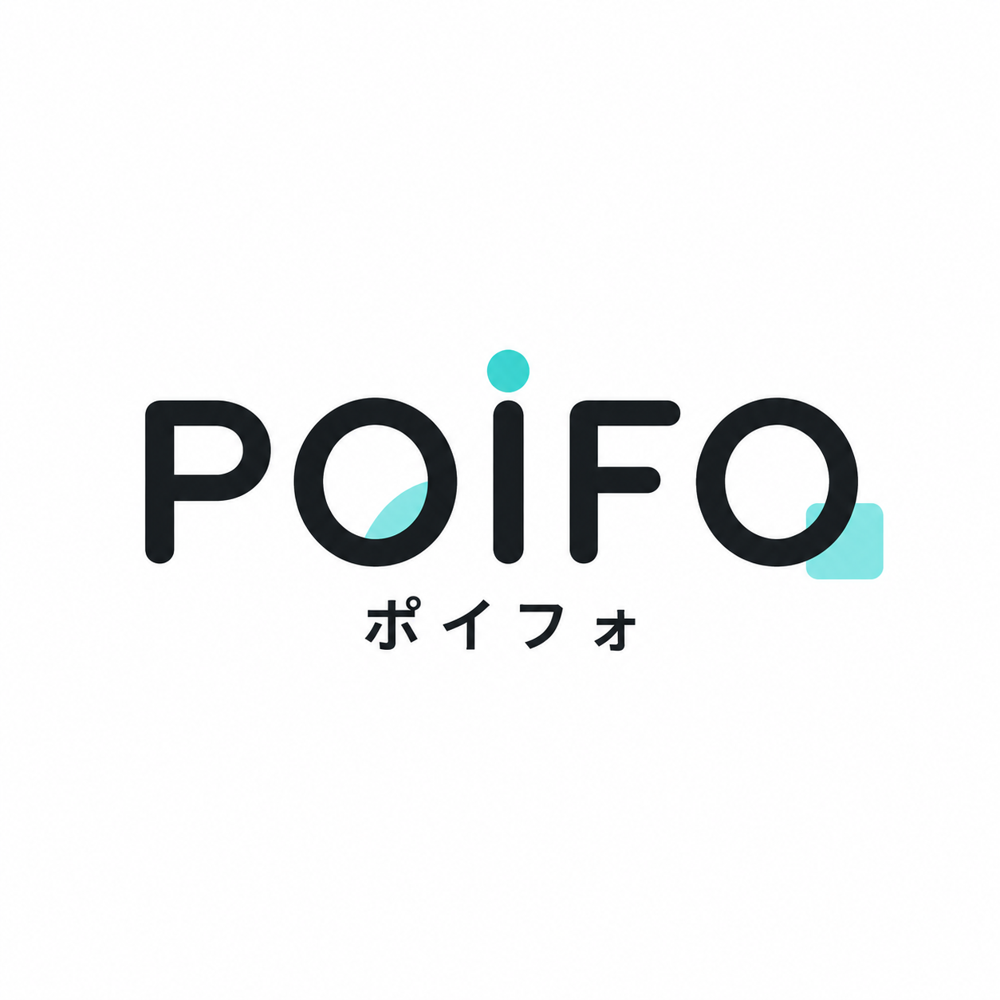

# ブランド資産

| ファイル | 内容 |
| --- | --- |
| [poifo-logo.png](poifo-logo.png) | 採用ロゴ（2026-11-20 納品、1254×1254 PNG） |

## ロゴから抽出した色

ロゴ画像のピクセルから取った値です（JPEG由来の揺れがあるため ±数値の誤差あり）。

| 部位 | HEX | 用途の目安 |
| --- | --- | --- |
| 文字（POIFO / ポイフォ） | `#1A1E21` | 見出し・本文の濃色 |
| iの点（濃いティファニーブルー） | `#3AD1CE` | メインのブランドカラー |
| 「O」の弧と右下の四角（淡い色） | `#86E4E4` | 薄い背景・装飾 |
| 背景 | `#FCFCFC` | 透過ではなくオフホワイト |

### 3色目（2026-11-21 追加）

ブランドの2色だけでは無機質に見えるため、キャラクター（ポイフォックス）の体のオレンジを3色目に加えました（yamadaさん指示）。

| 名前（CSS 変数） | HEX | 用途 |
| --- | --- | --- |
| `--color-accent` | `#F7A440` | 番号・A の印・見出しの下線・強調したい囲みの枠 |
| `--color-accent-strong` | `#B45A00` | ポイント数など、オレンジで文字を書くとき（白背景で読める濃さ） |
| `--color-accent-bg` | `#FFF4E6` | セクション・カードの淡い背景 |

旧仕様書の暫定値 `#81D8D0` は使わず、上の値を使います。サービス名・コピーは [specs/functional-spec.md](../specs/functional-spec.md) 1章。

## キャラクター「ポイフォックス（Poifox）」

2026-11-21 納品（7ポーズ＋エラー用・メンテナンス用。同じ画像が2組重複していたので除外）。サイトでは背景を透過にし、長辺480pxの WebP に縮小したものを [frontend/public/images/mascot/](../../frontend/public/images/mascot/) に置いています（1枚 35〜53KB）。納品原本（1254px 前後の PNG、背景は白）はリポジトリには入れず、プロジェクトの共有フォルダ `brand/mascot/original/` に保管しています。

| ファイル | ポーズ | 主な使いどころ |
| --- | --- | --- |
| poifox-wave.webp | 手を振る | トップのファーストビュー |
| poifox-cheer.webp | 座って応援 | 初めての方へ |
| poifox-point.webp | 指さし | 貯め方 STEP1、404 |
| poifox-guide.webp | チェックリストで説明 | 貯め方 STEP2 |
| poifox-get.webp | 「ポイントGET!」 | 貯め方 STEP3 |
| poifox-line.webp | 「LINEで相談」 | 担当サポート |
| poifox-event.webp | 「イベント参加」 | イベント |
| poifox-sorry.webp | 謝る（2026-11-21 追加納品、透過PNG） | エラーページ（404・500、サーバ側のエラー画面） |
| poifox-maintenance.webp | 整備士（2026-11-21 追加納品、透過PNG。横長なので長辺640px） | メンテナンス画面（フロント `/maintenance/`、サーバ側の 503） |
| poifox-welcome.webp | Pコインを持ってお出迎え（2026-11-26 納品、透過PNG） | S07 会員登録完了「ポイフォへようこそ！」 |
| poifox-peek.webp | 縁につかまってのぞき込む（2026-11-27 納品、透過PNG。下端が手で切れた絵。周りの見えない光を落として 480×292） | S01 トップのキービジュアルの下の縁と、ページの一番下（フッターの上の縁） |

2026-11-26 にキャラクター素材16枚と原案2枚が届きました。うち9枚と原案2枚（「正式キャラクター原案」「正式マスコット原案_別名保存」）は上の表の原本とピクセル単位で同じなので、追加はありません。デザイン（帽子と「Poifox」のバンダナ）も今の画像と同じです。新しく増えたものは次のとおりです。

| 共有フォルダのファイル | 内容 | 扱い |
| --- | --- | --- |
| `brand/mascot/original/poifox-welcome.png` | Pコインを持ってお出迎え、ハートの吹き出し（透過） | **採用**。S07 会員登録完了 |
| `brand/mascot/original/poifox-maintenance-wide.png` | 整備士（今の maintenance と同じ絵で、横に余白が広い版） | 予備 |
| `brand/mascot/original/poifox-maintenance-wand.png` | ヘルメット・誘導灯・コーンの工事中ポーズ（透過） | 予備（メンテナンス画面の別案。今の整備士のまま） |
| `brand/visuals/drafts/poifox-maintenance-wand-alt1.png`・`-alt2.png` | 上の工事中ポーズのほぼ同じ別版 | 使わない |
| `brand/visuals/drafts/error-sorry-1.png`〜`-4.png` | 「ごめんなさい」と文言・謝るポイフォックスを1枚にしたエラー画面案（4案、文言違い） | 使わない。エラー画面は文言を HTML で書き、絵は `poifox-sorry.webp` のまま（文字入りの画像だと 404・500 で文言を変えられず、読み上げもできないため）。淡いアクアの角の飾りは S17・S18 の見た目の参考にする |

## キービジュアル・説明画像（2026-11-26 納品）

納品原本（PNG）はプロジェクトの共有フォルダ `brand/visuals/original/` に保管（リポジトリには入れない）。サイトでは幅960px（480px表示の2倍）の WebP に縮小して [frontend/public/images/visuals/](../../frontend/public/images/visuals/) に置き、`src/components/Visual.astro` で表示する。変換スクリプトは共有フォルダの `brand/visuals/convert.py`（縮小・切り詰め・OGP）と `brand/visuals/feature-icons.py`（特徴アイコンの切り出し・にじみ消し）。

| サイトのファイル | 元の画像 | 加工 |
| --- | --- | --- |
| `visuals/how-points-work.webp` | how-points-work | 下の余白を切り詰め（高さ1312→1010）て縮小 |
| `visuals/banner-wide-3-shopping.webp`・`banner-wide-4-start.webp`・`kv-tall-follow-b.webp` | 同じ名前 | 縮小のみ |
| `visuals/bg-aqua-wave.webp` | bg-aqua-wave | 幅720px（背景なので軽くする） |
| `ogp.jpg` | banner-wide-1-easy | 上下を31pxずつ切って 1200×630 の JPEG（WebP を読めない SNS があるため） |

| 共有フォルダのファイル名 | 納品時の名前 | 内容 | 使う場所（画面仕様） | 注意 |
| --- | --- | --- | --- | --- |
| `kv-aqua-mascot.png` | キービジュアル案 | ティファニーブルー地に白帯の見出し「ひとりじゃない、あたらしいポイ活。」と説明文、右下にポイフォックス（1190×1322） | 予備（2026-11-26 に S01 ファーストビューで採用 → 2026-11-27 に `kv-aqua-features` へ差し替え） | 文字が画像に入っているので、`alt` にコピーと説明文を入れ、見出しは画面に出さない形で HTML にも書く（検索・読み上げ用）。CTA ボタンは画像の下に HTML で置く |
| `kv-aqua-features.png` | トップキービジュアル_ティファニーブルー_3つの特徴 | 同じ見出し＋特徴3つ（LINEで相談できる／みんなでポイ活／月末締め・翌月まとめ払い）（1190×1322） | 予備（2026-11-27 に S01 ファーストビューで採用 → 同日のデザイン更新で `kv-hitori-janai` に差し替え。サイトのファイルは削除） | 文字が画像に入っているので、`alt` にコピー・説明文・特徴3つを入れ、見出しは画面に出さない形で HTML にも書く。CTA ボタンは画像の下に HTML で置く。「月末締め・翌月まとめ払い」は、月末にまとめて承認して振り込む銀行振込の処理（機能仕様 7.3）に合わせた表現 |
| `kv-white-features.png` | トップキービジュアル_キャラなし | 白地の別案。特徴3つと「申請不要で、獲得ポイントをまとめて反映予定」（1100×1430） | 使わない | 「申請不要」が今の仕様（会員が換金を申請する）と食い違う |
| `how-points-work.png` | ポイントが貯まる仕組み_説明画像 | 「ポイフォの登録は無料なのに、なぜポイントが貯まるの？」と、ユーザー・ポイフォ・企業の3者の図（1199×1312） | S15 ヘルプの「ポイントの貯め方」（S01 は 2026-11-27 のデザイン更新で `section-how-points-work` に差し替え） | 下の余白が大きいので切り詰める。`alt` に説明文を入れる |
| `feature-icons-3.png` | 特徴アイコン3種_スマホ相談みんな | 透過のアイコン3つ（スマホ・吹き出し・人々）が横に並んだ1枚（2172×724） | 予備（S01「ポイフォの特徴」で使っていたが、2026-11-27 のデザイン更新で `section-features` に差し替え。サイトのファイルは削除） | 1つずつ切り出して使う。左のアイコンの右上に黄色いにじみがあるので消す |
| `bg-aqua-wave.png` | 白地に淡いアクアの波 | 文字なしの背景。下に淡いアクアの波（1086×1448） | S06 ログイン、S07 登録完了の背景。トップの「最後の登録導線」の背景 | 背景なので CSS で下に敷く。スマホで波が下端に来るよう配置 |
| `logo-minimal.png` | ミニマルなポイフォロゴ | 採用済みロゴと同じ画像（ピクセル単位で一致） | 変更なし（[poifo-logo.png](poifo-logo.png) を使い続ける） | 透過版・横組み版は引き続き未納品 |

## キービジュアル・バナー（2026-11-26 2回目の納品）

保管場所は上と同じ `brand/visuals/original/`（使わないものは `brand/visuals/drafts/`）。共有フォルダの直下にある日本語名の納品ファイルを、英語名でコピーしたものです。

| 共有フォルダのファイル名 | 納品時の名前 | 内容 | 使う場所（画面仕様） | 注意 |
| --- | --- | --- | --- | --- |
| `kv-tall-follow-b.png` | 25_キービジュアル_縦長フォロー | 「みんなでポイ活、はじめてからもしっかりフォロー」＋特徴3つ（かんたんにポイントが貯まる／はじめてでも安心／困ったときはサポート!）（1024×1536） | **S14 担当サポートの上部** | `alt` にコピーを入れる |
| `kv-tall-follow-a.png` | 24_キービジュアル_縦長みんなでポイ活 | 上とほぼ同じで、読点なし・「フォロー!」の版 | 予備 | b と a のどちらを使うかは好みで差し替えてよい |
| `banner-wide-1-easy.png` | 31_キービジュアル_横長案1 | 「ポイフォでかんたんポイ活」（1672×941） | **OGP 画像**（SNS で共有されたときの画像。1200×630 に上下を少し切って書き出す） | サービス名が入っているのはこの1枚だけ |
| `banner-wide-4-start.png` | 35_キービジュアル_横長案4 | 「いつもの行動でポイントがたまる! ポイフォで、無理なくおトクなポイ活はじめよう!」（1672×941） | **S15 はじめての方へ・ヘルプの上部** | |
| `banner-wide-3-shopping.png` | 34_キービジュアル_横長案3 | 「いつものポイ活でポイントがたまる! サービスの利用やお買い物でおトクにポイントをゲット!」（1774×887） | **S02 案件一覧の見出しの上** | ゲーム機のアイコンあり（ゲーム案件は増える見込みなので、このまま使う。2026-11-26 yamadaさん） |
| `banner-wide-plain.png` | 33_キャラクターバナー_文字なし | 文字なし。コインを持つポイフォックス、パソコン、プレゼント箱（1672×941） | 予備（S01「貯めたポイントの使い道」は 2026-11-27 にトップから外した。サイトのファイルは削除） | 文字がないので見出しは HTML で書く |
| `banner-wide-2-daily.png` | 32_キービジュアル_横長案2 | 「いつもの行動でポイントがたまる! 日常のちょっとした行動が、おトクにつながるポイントサイトです。」 | 予備 | ゲーム機のアイコンあり（このまま使ってよい） |
| `banner-wide-5-net.png` | 36_キービジュアル_横長案5 | 「いつものネット利用がポイントになる!」 | 予備 | ゲーム機のアイコンあり（このまま使ってよい） |
| `banner-wide-6-net-icons.png` | 37_キービジュアル_横長案6 | 「いつものネット利用でポイントがたまる!」＋ショッピング／サービス申込／ゲーム | 予備 | 「ゲーム」の文字あり（このまま使ってよい） |
| `drafts/kv-mobile-lp.png` | 30_キービジュアル_モバイル案 | 「ひとりじゃない、みんなでやるポイ活」＋「LINEではじめる」ボタン＋「LINEを使わない方はこちら」（941×1672） | 使わない | ボタンが画像に入っていて押せない。「LINEを使わない方はこちら」が今の仕様（LINE でだけ登録・ログイン）と食い違う |

S01 のファーストビューは 2026-11-27 のデザイン更新で `kv-hitori-janai` になりました（下の「トップのデザイン更新」）。

## トップのデザイン更新（2026-11-27 納品）

先方からトップ（スマホ）の完成イメージ1枚とセクション画像が届き、S01 をその並びに作り替えた（画面仕様 S01）。原本・元のファイル名・画像の表記と今の仕様の食い違いの資料は共有フォルダ `brand/redesign/README.md`。

- 2026-11-27 yamada さん: キービジュアル以外の追加画像は、左上・左下・右下の波模様はいらない → 共有フォルダ `brand/redesign/no-wave/`（波を背景色で塗りつぶした版）を使う
- 書き出しは共有フォルダ `brand/redesign/convert.py`（幅960px＝480px表示の2倍の WebP。セクション画像は上下の余白を詰める）

| サイトのファイル | 元の画像 | S01 の場所 |
| --- | --- | --- |
| `visuals/kv-hitori-janai.webp` | `original/kv-hitori-janai.png`（波あり、そのまま） | ファーストビュー |
| `visuals/section-category-menu.webp` | `no-wave/section-category-menu.png` | 案件メニュー5行（画像の上に行ごとの透明なリンクを重ねる。行の位置は `src/pages/index.astro` の `MENU_ROWS` に % で持つので、画像を差し替えたら測り直す） |
| `visuals/section-minna-de-poikatsu.webp` | `no-wave/section-minna-de-poikatsu.png` | みんなでポイ活 |
| `visuals/section-staff-consult.webp` | `no-wave/section-staff-consult.png` | 担当スタッフに相談 |
| `visuals/section-features.webp` | `no-wave/section-features.png` | ポイフォの特徴 |
| `visuals/section-how-to-earn.webp` | `no-wave/section-how-to-earn.png` | ポイントの貯め方 |
| `visuals/section-how-points-work.webp` | `no-wave/section-how-points-work.png` | ポイントがもらえるしくみ |
| `mascot/poifox-peek.webp` | `brand/mascot/original/poifox-peek.png` | キービジュアルの下の縁・ページの一番下 |

- `section-point-usage.png`（貯めたポイントの使い道）は使わない（2026-11-27 yamada さん。トップから外した）
- キービジュアルの「月末締め・翌月まとめ払い」と貯め方 STEP3 の「月末締め・翌月まとめ払いです。」は、今の申請制の仕様（機能仕様 7章）と食い違う。振込日程の運用は未定のため、今回は画像のまま使う（2026-11-27 yamada さん。食い違いの資料は共有フォルダ `brand/redesign/README.md`）

## ログイン後のトップ（2026-11-28 納品）

一枚絵と部品ごとの見本（共有フォルダ `brand/redesign/mockup/top-member-mobile.png`・`member-top/`）が届いた。数字・案件は見本の値なので、画面は HTML/CSS で寄せて作る（画面仕様 S01「ログイン中の並び」）。絵だけ見本から切り出した。

| サイトのファイル | 元の画像 | 使う場所 |
| --- | --- | --- |
| `visuals/member-coins.webp` | `member-top/01-points.png` のコイン | ポイントの帯の左 |
| `visuals/member-support.webp` | `member-top/05-support-faq.png` のスマホ・吹き出し・人々 | 担当スタッフに相談の右 |

- 切り出しは共有フォルダ `brand/redesign/member_cut.py`（縁につながる白〜淡い水色を透明にする）。人々の後ろの淡い水色の丸も透明になる
- カテゴリのアイコンは見本に寄せた線のアイコンを `src/lib/category-icon.ts` に SVG で持つ

## フォント（2026-11-27 お試し）

先方の画像の文字に合わせて、サイトの文字を **M PLUS Rounded 1c**（Google Fonts と同じもの、SIL Open Font License）にした。画像は生成画像で実際のフォントはないが、見た目がいちばん近いのがこのフォントの ExtraBold〜Black（比較は共有フォルダ `brand/redesign/font-compare.png`）。

- 読み込み: `@fontsource/m-plus-rounded-1c` をビルドに同梱（Google のサーバに取りに行かない）。日本語は文字の範囲ごとに分かれたファイルで、ページで使う文字の分だけ読み込まれる。読み込むまでは端末のゴシック体で表示（`font-display: swap`）
- 太さ: 本文 400、太字 700、見出し（h1〜h3）とボタン 800
- エラー画面（StandaloneLayout）は外部ファイルに頼らない作りなので、端末のゴシック体のまま

## キャラクターの置き方（2026-11-27 yamada 指示）

トップはキャラクターが多すぎて鬱陶しいので間引き、マイページなどキャラクターがいない画面に少しずつ置く。

**決まり**
- 1画面に1体まで（トップの「ポイントの貯め方」3ステップは1つの図として数える）
- 案件・イベント・お知らせなどの一覧やカードの中には入れない
- 置くのは「画面の入口（見出しの横に小さく）」「空のとき」「完了したとき」「エラーのとき」
- 大きさの目安: 見出しの横 72px、空・完了・エラー 120px

**トップ（S01）から外すもの**

| 場所 | 今 | 直したあと |
| --- | --- | --- |
| ファーストビュー | `kv-aqua-mascot`（キャラ入り） | `kv-aqua-features`（キャラなし）に差し替え（2026-11-27） |
| みんなでポイ活！ | event | 外す |
| 担当サポート | line | 未ログインは外す。ログイン中はここだけ残す（ログイン中のトップの1体） |
| ポイントの貯め方 | point・guide・get の3体 | そのまま |
| 貯めたポイントの使い道 | `banner-wide-plain`（キャラ入り） | 外す（文字だけの囲みにする） |
| よくある質問 | guide | 外す |
| 最後の登録導線 | wave | 外す（上にキャラが続くため） |
| PC の右の案内（SideAside） | wave／get・line・guide | 一番上のカードだけ残し、下の2枚はキャラなし |

未ログインのトップはファーストビューと3ステップの2か所、ログイン中は担当サポートの1か所になる。

**2026-11-27 デザイン更新で変わったこと（yamada さん「KV 及び画面の一番下に散らしてください」）**

トップは、のぞき込むポイフォックス（`peek`）をキービジュアルの下の縁とページの一番下（フッターの上の縁）に置く。貯め方の3ステップは納品画像（キャラなし）に、担当スタッフの相談も納品画像になったので、上の表の point・guide・get・line は外れた。

- 未ログイン: キービジュアルとページの一番下の2か所（同じ `peek` を上と下に置く。yamada さんの指示なので「1画面1体」の例外）
- ログイン中: ページの一番下の1か所

**新しく置く画面**

| 画面 | 置く場所 | ポーズ |
| --- | --- | --- |
| S02 案件一覧 | 0件のとき | point |
| S03 案件詳細 | 案件が見つからない・掲載していないとき | sorry |
| S06 ログイン | 「LINEでログイン」の上 | wave |
| S08 ログインエラー | 文言の上 | sorry |
| S09 マイページ | 保有ポイントの帯の横（小さく） | get |
| S09 マイページ | 通帳の各タブが空のとき | point |
| S11 振込先口座の登録 | 見出しの横（小さく） | guide |
| S12 ポイント交換 | 交換先が準備中のとき | cheer |
| S20 交換先の詳細・申請 | 申請が完了したとき | get |
| S13 退会 | 見出しの横 | sorry |
| S22 お知らせ一覧 | 0件のとき | cheer |
| S23 お知らせ詳細 | 見つからないとき | sorry |
| S24 お気に入り | 0件のとき | point |
| 各画面共通 | 「読み込めませんでした」のとき | sorry |

S21 登録情報には置かない（入力・確認だけの画面のため）。

## 未対応

- 背景が透過ではなく、周囲の余白も大きいです。ヘッダー用には **透過PNGまたはSVG** の書き出しを依頼してください（白以外の背景に置けないため）
- 横組み（ロゴタイプのみ・カナなし）版、濃色背景用の反転版、favicon用は未納品です（OGP は `banner-wide-1-easy` を使う）
