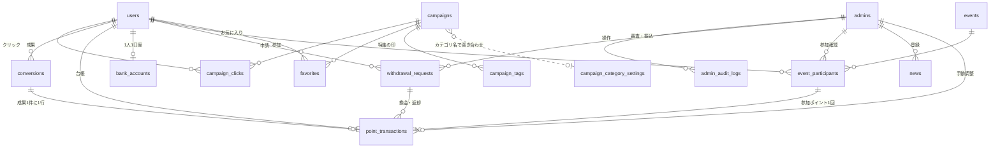

# ポイフォ｜テーブル定義

- 作成日: 2026年11月23日
- 元にしたもの: `backend/database/migrations/` の全マイグレーション（2026-11-26 のお気に入り・お知らせまで）
- DB: MySQL（Lightsail マネージドデータベース）。文字コードは utf8mb4
- 機能のルール: [functional-spec.md](functional-spec.md)

テーブルやカラムを変えたら、この文書も直す（マイグレーションが正。食い違ったらマイグレーションに合わせる）。

## 1. 一覧

| # | テーブル | 内容 | 機能仕様 |
|---|---|---|---|
| 1 | `users` | 会員（LINE ログイン） | 3章 |
| 2 | `admins` | 管理者 | 9章 |
| 3 | `admin_audit_logs` | 管理画面の操作ログ | 9.1 |
| 4 | `campaigns` | 案件（ASP から取り込んだもの＋運営の表示設定） | 4章 |
| 5 | `campaign_clicks` | 案件への遷移の記録 | 4.4 |
| 6 | `postback_logs` | 成果通知の受信ログ（全件） | 6章 |
| 7 | `conversions` | 成果（`cv_id` ごとに1行） | 6章 |
| 8 | `point_transactions` | ポイント台帳 | 5章 |
| 9 | `bank_accounts` | 振込先口座 | 7.4 |
| 10 | `withdrawal_requests` | 換金（ポイント交換）の申請 | 7章 |
| 11 | `events` | イベント | 8.1 |
| 12 | `event_participants` | イベントの参加 | 8.2 |
| 13 | `favorites` | お気に入り | 4.5 |
| 14 | `news` | お知らせ | 11.1 |
| 15 | `campaign_tags` | 案件の特集の印 | 4.3 |
| 16 | `campaign_category_settings` | カテゴリの表示設定（メニューのボタンの表示名・並び・出すか） | 4.7 |
| — | `sessions` `cache` `cache_locks` `jobs` `job_batches` `failed_jobs` | Laravel の仕組み用（セッション・キャッシュ・ロック・キュー）。API サーバを増やせるよう、すべて DB に置く | — |

## 2. テーブルのつながり

`postback_logs` はほかの表とつながない（拒否したものも含めて、受け取ったそのままを残すため）。`conversions` とは `cv_id` で突き合わせる。

## 3. 書き方

- 型は MySQL での型。`BIGINT UNSIGNED` の主キー `id` は自動採番
- 「NULL」欄の ○ は NULL を許す
- `created_at` / `updated_at`（`TIMESTAMP NULL`）は、特に書かない限りすべての表にある
- 「暗号化」はアプリの鍵（`APP_KEY`）で暗号化して保存する列。DB を見ても読めない。API サーバを増やすときは全台で同じ `APP_KEY` にする
- 状態などの決まった値は英字で保存し、画面では日本語に置き換える

## 4. 各テーブル

### 4.1 `users`（会員）

ログインは LINE だけ（メールアドレスは連絡用で、ログインには使わない）。退会しても行は消さず `status = withdrawn` にする（同じ LINE アカウントでの再登録を防ぐため）。

| カラム | 型 | NULL | 既定 | 説明 |
|---|---|---|---|---|
| `id` | BIGINT UNSIGNED | | | 主キー |
| `uid` | CHAR(26) | | | 会員ID（ULID）。ASP の計測リンクに `user_id` として付ける。一意 |
| `line_user_id` | VARCHAR(64) | | | LINE のユーザーID。外部には出さない。退会後も残す。一意 |
| `display_name` | VARCHAR(255) | ○ | | LINE の表示名。退会で消す |
| `avatar_url` | VARCHAR(1024) | ○ | | LINE のアイコン URL。退会で消す |
| `status` | VARCHAR(20) | | `active` | `active`（有効）／`suspended`（停止中）／`withdrawn`（退会済み） |
| `email` | VARCHAR(255) | ○ | | 連絡用メールアドレス（確認済みのもの。未実装、機能仕様 3.5）。確認済みのものの中で一意。退会で消す |
| `email_verified_at` | TIMESTAMP | ○ | | メールアドレスを確認した日時（未実装） |
| `email_marketing_opt_in` | TINYINT(1) | | 0 | お得情報のメールを受け取る（未実装） |
| `last_login_at` | TIMESTAMP | ○ | | 最終ログイン |
| `news_seen_at` | TIMESTAMP | ○ | | 最後にお知らせ一覧を開いた日時。未読の数はこれより後に公開されたお知らせの件数（空なら登録日時から数える） |
| `suspended_at` | TIMESTAMP | ○ | | 停止した日時 |
| `suspended_reason` | VARCHAR(255) | ○ | | 停止の理由（会員には見せない） |
| `withdrawn_at` | TIMESTAMP | ○ | | 退会した日時 |
| `remember_token` | VARCHAR(100) | ○ | | Laravel の仕組み用 |

インデックス: `uid`（一意）、`line_user_id`（一意）、`status`

### 4.2 `admins`（管理者）

会員とは別の表・別のログイン。二要素認証（認証アプリ）が必須。追加はサーバのコマンド（`admin:create`）で行う。

| カラム | 型 | NULL | 既定 | 説明 |
|---|---|---|---|---|
| `id` | BIGINT UNSIGNED | | | 主キー |
| `name` | VARCHAR(255) | | | 名前 |
| `email` | VARCHAR(255) | | | ログインに使うメールアドレス。一意 |
| `password` | VARCHAR(255) | | | パスワードのハッシュ |
| `two_factor_secret` | TEXT | ○ | | 認証アプリの秘密鍵。暗号化 |
| `two_factor_confirmed_at` | TIMESTAMP | ○ | | 認証アプリを登録した日時。空ならログイン後に登録画面へ |
| `two_factor_last_timestep` | BIGINT UNSIGNED | ○ | | 最後に使った6桁コードの時間枠（同じコードの使い回しを防ぐ） |
| `is_active` | TINYINT(1) | | 1 | 0 ならログインできない |
| `last_login_at` | TIMESTAMP | ○ | | 最終ログイン |
| `remember_token` | VARCHAR(100) | ○ | | Laravel の仕組み用 |

インデックス: `email`（一意）

### 4.3 `admin_audit_logs`（操作ログ）

管理画面で会員・ポイント・掲載内容・換金が変わる操作とログインを残す。`updated_at` はない（書き換えないため）。

| カラム | 型 | NULL | 既定 | 説明 |
|---|---|---|---|---|
| `id` | BIGINT UNSIGNED | | | 主キー |
| `admin_id` | BIGINT UNSIGNED | ○ | | 操作した管理者（→ `admins`。管理者を消したら NULL） |
| `action` | VARCHAR(64) | | | 操作の種類。例: `login.failed`、`two_factor.enabled`、`points.adjust`、`member.suspend`、`member.resume`、`campaign.update_display`、`event.create`、`event.update`、`event.delete`、`event.export_participants`、`conversion.release_hold`、`withdrawal.export` など |
| `target_type` | VARCHAR(64) | ○ | | 対象の種類（会員・申請など） |
| `target_id` | BIGINT UNSIGNED | ○ | | 対象の ID |
| `payload` | JSON | ○ | | 変更前後の値・理由など |
| `ip_address` | VARCHAR(45) | ○ | | 操作した IP |
| `created_at` | TIMESTAMP | | 現在時刻 | 操作した日時 |

インデックス: `target_type` + `target_id`

### 4.4 `campaigns`（案件）

GF Rewards の案件連携 API から15分ごとに取り込む。運営の表示設定（`is_hidden` 以下3つ）は取り込みで上書きしない。

| カラム | 型 | NULL | 既定 | 説明 |
|---|---|---|---|---|
| `id` | BIGINT UNSIGNED | | | 主キー（サイトの案件ID） |
| `provider` | VARCHAR(32) | | `gf_rewards` | ASP |
| `external_id` | VARCHAR(64) | | | ASP の案件ID |
| `name` | VARCHAR(255) | | | 案件名 |
| `description` | TEXT | ○ | | 案件の説明 |
| `conversion_condition` | TEXT | ○ | | 成果の条件・注意事項 |
| `category` | VARCHAR(64) | ○ | | カテゴリ（ASP の値のまま） |
| `platform` | VARCHAR(16) | ○ | | 対象端末: `ios`／`android`／`web`／`others` |
| `user_platforms` | JSON | ○ | | 利用できる端末の一覧 |
| `icon_url` | VARCHAR(1024) | ○ | | アイコン画像 |
| `click_url` | VARCHAR(2048) | | | 計測リンク（遷移時に `user_id=<uid>` を付ける） |
| `revenue_type` | VARCHAR(32) | ○ | | `fixed_amount`（定額）／`fixed_rate`（定率） |
| `max_points` | INT UNSIGNED | ○ | | 成果地点のうち最大のポイント（定額案件のみ） |
| `external_status` | VARCHAR(32) | ○ | | ASP 側の状態: `not_started`／`started`／`paused` |
| `starts_at` | TIMESTAMP | ○ | | 掲載開始 |
| `ends_at` | TIMESTAMP | ○ | | 掲載終了 |
| `conversion_actions` | JSON | ○ | | 成果地点の一覧（名前・説明・ポイント・承認までの日数など） |
| `raw` | JSON | ○ | | ASP から受け取った元のデータ |
| `synced_at` | TIMESTAMP | ○ | | 最後に取り込んだ日時 |
| `is_hidden` | TINYINT(1) | | 0 | 運営の設定: 1 ならサイトに出さない |
| `is_featured` | TINYINT(1) | | 0 | 運営の設定: おすすめ |
| `sort_order` | INT | | 0 | 運営の設定: 並び順（小さいほど前） |

インデックス: `provider` + `external_id`（一意）、`external_status` + `is_hidden`

### 4.5 `campaign_clicks`（案件への遷移）

問い合わせ対応・不正調査用。会員にもマイページの「案件の利用履歴」で直近90日を見せる（IP・ブラウザ情報は見せない）。`updated_at` はない。

| カラム | 型 | NULL | 既定 | 説明 |
|---|---|---|---|---|
| `id` | BIGINT UNSIGNED | | | 主キー |
| `user_id` | BIGINT UNSIGNED | | | 会員（→ `users`） |
| `campaign_id` | BIGINT UNSIGNED | | | 案件（→ `campaigns`） |
| `ip_address` | VARCHAR(45) | ○ | | 会員の IP |
| `user_agent` | TEXT | ○ | | ブラウザ情報 |
| `created_at` | TIMESTAMP | | 現在時刻 | 遷移した日時 |

インデックス: `user_id` + `created_at`（会員の利用履歴）

### 4.6 `postback_logs`（成果通知の受信ログ）

受け取った通知を、拒否したものも含めて全件残す。`updated_at` はない。

| カラム | 型 | NULL | 既定 | 説明 |
|---|---|---|---|---|
| `id` | BIGINT UNSIGNED | | | 主キー |
| `provider` | VARCHAR(32) | | `gf_rewards` | ASP |
| `method` | VARCHAR(8) | | | `GET`／`POST` |
| `ip_address` | VARCHAR(45) | ○ | | 送信元 IP |
| `params` | JSON | | | 受け取ったパラメータ |
| `cv_id` | VARCHAR(128) | ○ | | 成果ID |
| `hash_valid` | TINYINT(1) | | 0 | 署名が正しかったか |
| `result` | VARCHAR(32) | | | 結果: `granted`（確定）／`pending`（判定中）／`rejected`（否認）／`duplicate`（重複）／`held`（保留）／`unknown_user`（会員なし）／`withdrawn_user`（退会済み）／`invalid_hash`（署名不一致）／`invalid_params`（パラメータ不正）／`invalid_path`（パス違い）／`ip_denied`（IP 不一致）／`error`（処理の失敗） |
| `response_code` | TINYINT UNSIGNED | ○ | | ASP に返した本文 `0`／`1`／`2` |
| `error` | TEXT | ○ | | 失敗したときの内容 |
| `created_at` | TIMESTAMP | | 現在時刻 | 受信日時 |

インデックス: `cv_id`、`created_at`（短時間の大量受信の検知）

### 4.7 `conversions`（成果）

`cv_id` ごとに1行。状態は ASP の通知に合わせて変わる。

| カラム | 型 | NULL | 既定 | 説明 |
|---|---|---|---|---|
| `id` | BIGINT UNSIGNED | | | 主キー |
| `provider` | VARCHAR(32) | | `gf_rewards` | ASP |
| `cv_id` | VARCHAR(128) | | | ASP の成果ID |
| `user_id` | BIGINT UNSIGNED | ○ | | 会員（→ `users`）。会員が見つからないときは NULL |
| `external_user_id` | VARCHAR(128) | | | 通知に入っていた会員ID（`uid`） |
| `external_campaign_id` | VARCHAR(64) | ○ | | 通知に入っていた案件ID |
| `campaign_name` | VARCHAR(255) | ○ | | 案件名 |
| `cv_action_id` | VARCHAR(64) | ○ | | 成果地点ID |
| `cv_action_name` | VARCHAR(255) | ○ | | 成果地点名 |
| `status` | VARCHAR(16) | | | `pending`（未承認）／`approved`（承認）／`rejected`（否認） |
| `hold_reason` | VARCHAR(32) | ○ | | 保留の理由（NULL なら保留していない）: `unknown_user`／`unknown_campaign`／`unknown_action`／`amount_mismatch`／`amount_over_limit` |
| `held_at` | TIMESTAMP | ○ | | 保留にした日時 |
| `points` | INT UNSIGNED | | | 通知のポイント（承認で付与する数） |
| `expected_points` | INT UNSIGNED | ○ | | 取り込み済みの案件情報でのポイント（定額案件の突き合わせ用） |
| `net_cost` | DECIMAL(12,2) | ○ | | 自社への報酬額 |
| `cv_at` | TIMESTAMP | ○ | | 成果の発生日時 |
| `authenticated_at` | TIMESTAMP | ○ | | 承認・否認された日時 |
| `last_payload` | JSON | | | 最後に受けた通知の内容 |

インデックス: `provider` + `cv_id`（一意。二重付与を防ぐ）、`hold_reason`

### 4.8 `point_transactions`（ポイント台帳）

1件ずつの記録。残高は `confirmed` の合計（利用可能）、`pending` の合計（判定中）で出す。

| カラム | 型 | NULL | 既定 | 説明 |
|---|---|---|---|---|
| `id` | BIGINT UNSIGNED | | | 主キー |
| `user_id` | BIGINT UNSIGNED | | | 会員（→ `users`） |
| `type` | VARCHAR(32) | | | 種類: `conversion`（案件の成果）／`adjustment`（運営による調整）／`withdrawal`（換金）／`withdrawal_refund`（換金の取り消し・返却）／`event_reward`（イベント参加）／`referral`（紹介報酬）／`referral_initial`（紹介の初回特典）／`expiry`（失効） |
| `status` | VARCHAR(16) | | | `pending`（判定中）／`confirmed`（確定）／`rejected`（否認） |
| `points` | INT | | | ポイント。付与は正、換金・失効は負 |
| `description` | VARCHAR(255) | ○ | | 履歴に出す説明（案件名、調整の理由、「ポイント交換（銀行振込）」など） |
| `conversion_id` | BIGINT UNSIGNED | ○ | | 成果（→ `conversions`）。一意（成果1件につき1行） |
| `withdrawal_request_id` | BIGINT UNSIGNED | ○ | | 換金申請（`withdrawal_requests` の id。外部キーは張っていない） |
| `event_participant_id` | BIGINT UNSIGNED | ○ | | イベントの参加（→ `event_participants`）。一意（参加ポイントは1回だけ） |
| `admin_id` | BIGINT UNSIGNED | ○ | | 手動調整した管理者（→ `admins`） |
| `confirmed_at` | TIMESTAMP | ○ | | 確定した日時 |

インデックス: `user_id` + `status`、`conversion_id`（一意）、`event_participant_id`（一意）、`withdrawal_request_id`

### 4.9 `bank_accounts`（振込先口座）

1人1口座。退会しても残す（同じ口座の再利用を見つけるため）。

| カラム | 型 | NULL | 既定 | 説明 |
|---|---|---|---|---|
| `id` | BIGINT UNSIGNED | | | 主キー |
| `user_id` | BIGINT UNSIGNED | | | 会員（→ `users`）。一意 |
| `bank_code` | CHAR(4) | | | 金融機関コード |
| `bank_name` | VARCHAR(255) | ○ | | 金融機関名 |
| `branch_code` | CHAR(3) | | | 支店コード |
| `branch_name` | VARCHAR(255) | ○ | | 支店名 |
| `account_type` | VARCHAR(16) | | | `ordinary`（普通）／`checking`（当座）／`savings`（貯蓄） |
| `account_number` | TEXT | | | 口座番号。暗号化 |
| `account_holder_kana` | VARCHAR(255) | | | 口座名義（全銀の半角カナにそろえて保存） |
| `holder_name` | VARCHAR(255) | ○ | | 氏名（漢字）。振込用 CSV に出す |
| `account_fingerprint` | CHAR(64) | | | 銀行・支店・種別・番号から作ったハッシュ（HMAC）。同じ口座がほかの会員にないかを調べる |
| `holder_name_key` | VARCHAR(255) | | | 空白を除いた名義。同じ名義の検知に使う |

インデックス: `user_id`（一意）、`account_fingerprint`、`holder_name_key`

### 4.10 `withdrawal_requests`（換金の申請）

申請 → 審査（承認／却下）→ 完了（振込済みなど）。交換先が増えても同じ表に入れる。

| カラム | 型 | NULL | 既定 | 説明 |
|---|---|---|---|---|
| `id` | BIGINT UNSIGNED | | | 主キー（申請ID） |
| `user_id` | BIGINT UNSIGNED | | | 会員（→ `users`） |
| `exchange_method` | VARCHAR(40) | | `bank_transfer` | 交換先コード（設定は `config/poifo.php` の `exchange_methods`） |
| `points` | INT UNSIGNED | | | 交換したポイント |
| `yen_per_point` | DECIMAL(12,4) | ○ | | 申請時点の交換レート |
| `amount_yen` | INT UNSIGNED | | | 換金額（円） |
| `fee_yen` | INT UNSIGNED | | 0 | 手数料（円）。振込額は `amount_yen - fee_yen` |
| `status` | VARCHAR(16) | | `requested` | `requested`（申請中）／`approved`（承認済み）／`paid`（完了）／`rejected`（却下） |
| `recipient_snapshot` | TEXT | ○ | | 申請時点の受け取り情報の控え（銀行振込なら口座情報）。暗号化 |
| `reviewable_after` | TIMESTAMP | ○ | | 審査期間の終わり。これより前は承認できない |
| `reviewed_by` | BIGINT UNSIGNED | ○ | | 承認・却下した管理者（→ `admins`） |
| `reviewed_at` | TIMESTAMP | ○ | | 承認・却下した日時 |
| `review_note` | VARCHAR(255) | ○ | | 審査のメモ |
| `export_batch` | VARCHAR(32) | ○ | | 振込用 CSV を出したときのまとまりの番号 |
| `paid_at` | TIMESTAMP | ○ | | 完了にした日時 |
| `paid_by` | BIGINT UNSIGNED | ○ | | 完了にした管理者（→ `admins`） |

インデックス: `status` + `created_at`、`exchange_method` + `created_at`、`export_batch`

### 4.11 `events`（イベント）

| カラム | 型 | NULL | 既定 | 説明 |
|---|---|---|---|---|
| `id` | BIGINT UNSIGNED | | | 主キー |
| `title` | VARCHAR(255) | | | タイトル（画面では100文字まで） |
| `summary` | TEXT | ○ | | 概要（一覧のカード） |
| `body` | TEXT | ○ | | 本文 |
| `starts_at` | TIMESTAMP | | | 開始日時 |
| `ends_at` | TIMESTAMP | ○ | | 終了日時 |
| `format` | VARCHAR(64) | ○ | | 形式（「オンライン」など） |
| `thumbnail_url` | VARCHAR(1024) | ○ | | サムネイル画像 |
| `openchat_url` | VARCHAR(1024) | ○ | | オープンチャットの URL（参加した会員にだけ見せる） |
| `capacity` | INT UNSIGNED | ○ | | 参加上限人数。NULL なら上限なし |
| `reward_points` | INT UNSIGNED | | 0 | 参加ポイント。0 なら付与しない |
| `notes` | TEXT | ○ | | 注意事項 |
| `status` | VARCHAR(16) | | `draft` | `draft`（下書き）／`published`（公開）／`ended`（終了） |
| `sort_order` | INT | | 0 | 並び順（小さいほど前） |

インデックス: `status` + `starts_at`

### 4.12 `event_participants`（イベントの参加）

イベントと会員の組で1行。参加したかどうかはこの表で判定する。

| カラム | 型 | NULL | 既定 | 説明 |
|---|---|---|---|---|
| `id` | BIGINT UNSIGNED | | | 主キー |
| `event_id` | BIGINT UNSIGNED | | | イベント（→ `events`） |
| `user_id` | BIGINT UNSIGNED | | | 会員（→ `users`） |
| `status` | VARCHAR(16) | | | `joined`（参加予定）／`cancelled`（取り消し）／`attended`（参加済み）／`absent`（不参加） |
| `joined_at` | TIMESTAMP | | | 参加した日時（取り消し後にもう一度参加したら更新） |
| `cancelled_at` | TIMESTAMP | ○ | | 取り消した日時 |
| `checked_at` | TIMESTAMP | ○ | | 管理者が参加済み／不参加を付けた日時 |
| `checked_by` | BIGINT UNSIGNED | ○ | | 付けた管理者（→ `admins`） |

インデックス: `event_id` + `user_id`（一意）、`event_id` + `status`

### 4.13 `favorites`（お気に入り）

機能仕様 4.5。1人200件まで。掲載が終わった案件も行は残す（一覧で「掲載終了」と出す）。`updated_at` はない。

| カラム | 型 | NULL | 既定 | 説明 |
|---|---|---|---|---|
| `id` | BIGINT UNSIGNED | | | 主キー |
| `user_id` | BIGINT UNSIGNED | | | 会員（→ `users`） |
| `campaign_id` | BIGINT UNSIGNED | | | 案件（→ `campaigns`） |
| `created_at` | TIMESTAMP | | 現在時刻 | 登録した日時（一覧の並びに使う） |

インデックス: `user_id` + `campaign_id`（一意）、`campaign_id`（案件ごとのお気に入り数）

### 4.14 `news`（お知らせ）

機能仕様 11.1。会員サイトに出すのは `published` で `published_at` を過ぎ、`expires_at` の前のもの。削除できるのは下書きだけ。

| カラム | 型 | NULL | 既定 | 説明 |
|---|---|---|---|---|
| `id` | BIGINT UNSIGNED | | | 主キー |
| `title` | VARCHAR(255) | | | タイトル（画面では100文字まで） |
| `body` | TEXT | | | 本文（5,000文字まで） |
| `is_important` | TINYINT(1) | | 0 | 重要 |
| `status` | VARCHAR(16) | | `draft` | `draft`（下書き）／`published`（公開） |
| `published_at` | TIMESTAMP | ○ | | 公開日時（公開にするときは必須） |
| `expires_at` | TIMESTAMP | ○ | | 公開終了日時 |
| `created_by` | BIGINT UNSIGNED | ○ | | 登録した管理者（→ `admins`。管理者を消したら空にする） |
| `created_at` / `updated_at` | TIMESTAMP | ○ | | |

インデックス: `status` + `published_at`

### 4.15 `campaign_tags`（案件の特集の印）

機能仕様 4.3。トップの案件メニューの「はじめて向け」「ゲーム案件特集」「みんなで挑戦中」を、管理画面で案件に付ける（2026-11-27）。ASP の取り込みでは触らない。特集を増やしても列を足さずに済むよう、案件と印の組を1行にする。案件を消すと一緒に消える。`updated_at` はない。

| カラム | 型 | NULL | 既定 | 説明 |
|---|---|---|---|---|
| `id` | BIGINT UNSIGNED | | | 主キー |
| `campaign_id` | BIGINT UNSIGNED | | | 案件（→ `campaigns`。消したら一緒に消す） |
| `tag` | VARCHAR(32) | | | `beginner`（はじめて向け）／`game`（ゲーム案件特集）／`together`（みんなで挑戦中）。値の一覧はコードの `Campaign::TAGS` |
| `created_at` | TIMESTAMP | | 現在時刻 | 付けた日時 |

インデックス: `campaign_id` + `tag`（一意）、`tag`（特集ごとの一覧）

### 4.16 友達紹介のためのテーブル・カラム

機能仕様 15章。マイグレーション `2026_11_28_000100_create_referral_tables`（ランクと初回特典の仮の値もここで入れる）。

`users` に足すカラム:

| カラム | 型 | NULL | 既定 | 説明 |
|---|---|---|---|---|
| `referral_code` | VARCHAR(16) | ○ | | 紹介コード（一意。初めて紹介ページを開いたときに発行） |
| `referred_by_user_id` | BIGINT UNSIGNED | ○ | | 紹介元（→ `users`）。登録のときだけ入れ、あとで変えない |
| `referral_disabled_at` | TIMESTAMP | ○ | | 管理者が紹介を無効にした日時（理由は操作ログ） |
| `referral_partner_rate` | DECIMAL(5,2) | ○ | | 特別パートナーの率（%）。空なら一般のランク |

`campaigns` に足すカラム: `referral_excluded`（TINYINT(1)、既定0、紹介報酬の対象外）、`referral_rate_cap`（DECIMAL(5,2)、NULL 可、率の上限 %）。

`referral_ranks`（ランク。管理画面 A17 で変える）: `id`、`code`（VARCHAR(16)、一意。`partner` は特別パートナー用で消せない）、`name`（表示名）、`rate`（DECIMAL(5,2)、%。特別パートナーは上限）、`min_valid_referrals`（INT UNSIGNED、必要な有効紹介人数。特別パートナーは使わない）、`sort_order`、`created_at` / `updated_at`。

`referral_settings`（1行だけ）: `initial_bonus_points`（初回特典のポイント、仮100）、`initial_threshold_points`（条件のポイント、仮1,000）、`initial_days`（期限の日数、仮180）、`created_at` / `updated_at`。

`referral_rewards`（紹介報酬。ポイントの増減そのものは `point_transactions` に入れ、ここは計算の根拠を残す）:

| カラム | 型 | NULL | 既定 | 説明 |
|---|---|---|---|---|
| `id` | BIGINT UNSIGNED | | | 主キー |
| `referrer_user_id` | BIGINT UNSIGNED | | | 紹介した人（→ `users`） |
| `referee_user_id` | BIGINT UNSIGNED | | | 紹介した友達（→ `users`） |
| `type` | VARCHAR(16) | | | `ongoing`（紹介報酬）／`initial`（初回特典） |
| `conversion_id` | BIGINT UNSIGNED | ○ | | 元の成果（→ `conversions`。初回特典は空） |
| `base_points` | INT UNSIGNED | | 0 | 元にしたポイント |
| `rate` | DECIMAL(5,2) | ○ | | 使った率（%。初回特典は空） |
| `rank` | VARCHAR(16) | ○ | | そのときのランクの `referral_ranks.code` |
| `rank_name` | VARCHAR(32) | ○ | | そのときのランクの表示名（ランクは消せるので残す） |
| `points` | INT UNSIGNED | | | 付けたポイント |
| `point_transaction_id` | BIGINT UNSIGNED | ○ | | 台帳の行（→ `point_transactions`） |
| `created_at` / `updated_at` | TIMESTAMP | ○ | | |

インデックス: `conversion_id` + `type`（一意。二重に付けない）、`referee_user_id` + `type`（初回特典を1回だけにするため、アプリで確かめる）、`referrer_user_id` + `created_at`。状態（判定中・確定・否認）は `point_transactions` の状態を使う。

### 4.17 `campaign_category_settings`（カテゴリの表示設定）

機能仕様 4.7。ハンバーガーメニューの「カテゴリから探す」のボタンに出す短い表示名・並び・出すかどうかを、ASP のカテゴリ名ごとに1行持つ（管理画面 A18、2026-11-28）。行がないカテゴリは「ASP の名前のまま・件数順・出す」。`campaigns` とは外部キーでつながず、カテゴリ名で突き合わせる（カテゴリは ASP の文字列で、表がないため）。作ったときに見本の名前の9行を入れる。

| カラム | 型 | NULL | 既定 | 説明 |
|---|---|---|---|---|
| `id` | BIGINT UNSIGNED | | | 主キー |
| `category` | VARCHAR(64) | | | ASP のカテゴリ名（`campaigns.category` と同じ値） |
| `label` | VARCHAR(32) | ○ | | メニューのボタンに出す表示名。NULL なら ASP の名前のまま |
| `sort_order` | INT | ○ | | 並び順（小さいほど前）。NULL のものは決めたもののあとに掲載中の件数の多い順 |
| `in_menu` | BOOLEAN | | true | メニューに出すか |

インデックス: `category`（一意）

### 4.18 `email_verifications`（メールアドレスの確認、未実装・案）

機能仕様 3.5。確認メールのリンクに使う。確認できたら `users.email` に移し、この行は消す。

| カラム | 型 | NULL | 既定 | 説明 |
|---|---|---|---|---|
| `id` | BIGINT UNSIGNED | | | 主キー |
| `user_id` | BIGINT UNSIGNED | | | 会員（→ `users`） |
| `email` | VARCHAR(255) | | | 確認中のアドレス |
| `token_hash` | CHAR(64) | | | リンクのトークンの SHA-256（トークンそのものは持たない）。一意 |
| `expires_at` | TIMESTAMP | | | 有効期限（送ってから24時間） |
| `created_at` | TIMESTAMP | | | 送った日時（再送の回数制限に使う） |

インデックス: `token_hash`（一意）、`user_id`

## 5. 気づいた点

- `events` を作ったマイグレーションのコメントに「参加管理はしない」とあるが、2026-11-20 の方針変更で参加を管理するようになっている（`event_participants`）。動きには関係ない
- `point_transactions.withdrawal_request_id` だけ外部キーを張っていない（ほかの参照列は張っている）。必要なら実装スレッドで追加する
